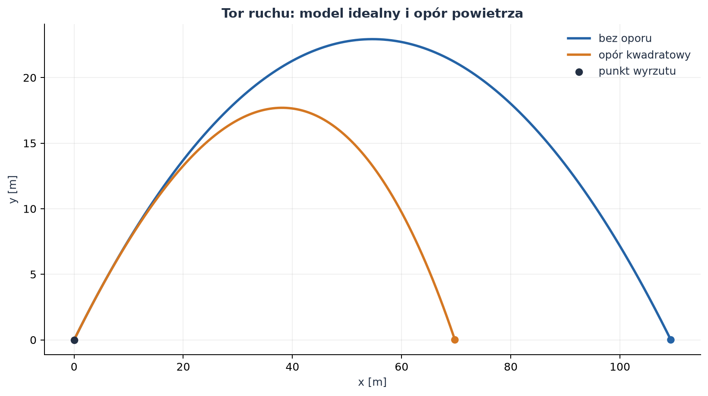
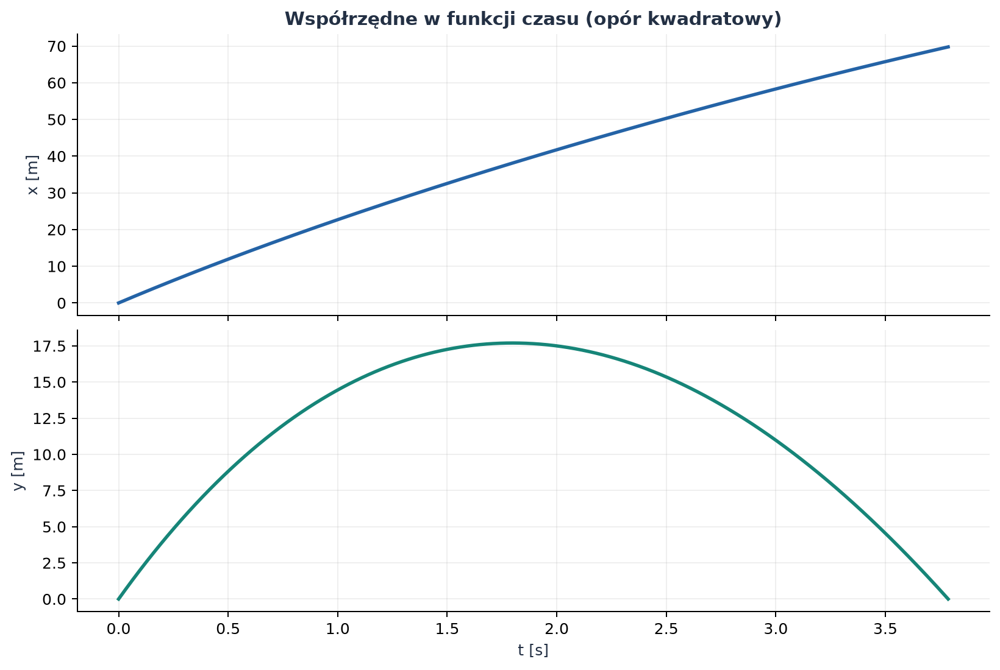
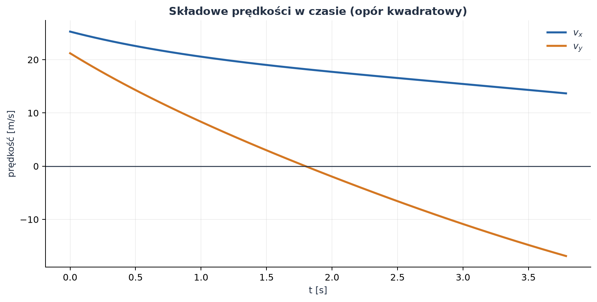
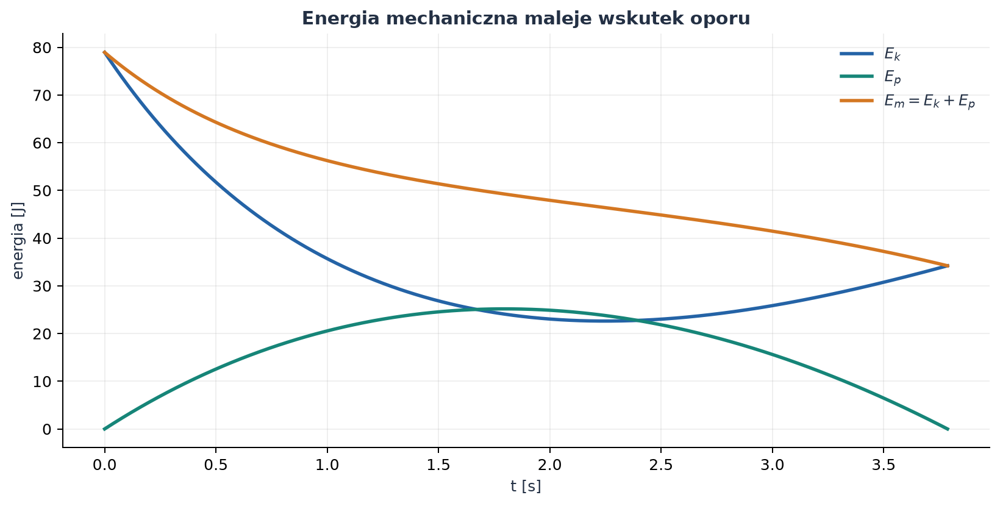
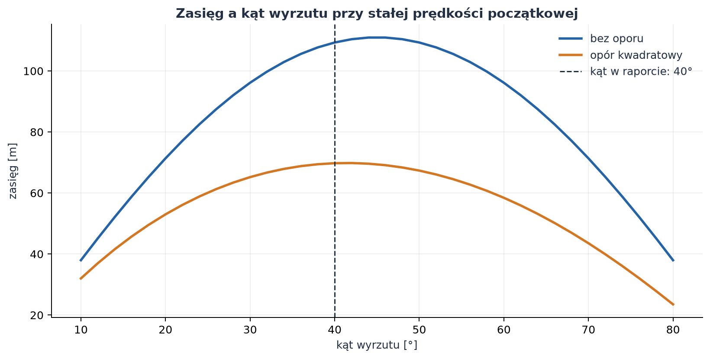

# Rzut ukośny — od paraboli do oporu powietrza

*Raport obliczeniowy i przykład wykorzystania Markdown, Pythona oraz wykresów w dokumentacji naukowej.*

**Temat:** ruch ciała wyrzuconego pod kątem do poziomu, bez oporu i z oporem powietrza.  
**Metoda:** wyprowadzenie analityczne dla modelu idealnego oraz całkowanie numeryczne modelu z oporem kwadratowym.  
**Charakter danych:** symulacja modelowa, nie pomiar laboratoryjny.

Rzut ukośny można zrozumieć jako dwa jednoczesne ruchy: poziomy, który w próżni jest jednostajny, i pionowy, który jest swobodnym spadkiem z początkową prędkością skierowaną w górę. Gdy uwzględnimy opór powietrza, składowe przestają być niezależne: siła oporu zależy od całego wektora prędkości i zmienia się w czasie.

## Spis treści

1. [Cel i założenia](#1-cel-i-założenia)
2. [Rzut bez oporu powietrza](#2-rzut-bez-oporu-powietrza)
3. [Przykład liczbowy bez oporu](#3-przykład-liczbowy-bez-oporu)
4. [Rzut z oporem powietrza](#4-rzut-z-oporem-powietrza)
5. [Wyniki symulacji i wykresy](#5-wyniki-symulacji-i-wykresy)
6. [Kod i odtwarzanie wyników](#6-kod-i-odtwarzanie-wyników)
7. [Ograniczenia modelu](#7-ograniczenia-modelu)
8. [Wnioski](#8-wnioski)

---

## 1. Cel i założenia

Celem jest wyznaczenie toru, czasu lotu, maksymalnej wysokości i zasięgu, a następnie porównanie wyniku idealnego z ruchem w powietrzu. Przyjmujemy prędkość początkową $v_0=33\,\mathrm{m/s}$ oraz kąt wyrzutu $\alpha=40^\circ$. Początek układu współrzędnych znajduje się w punkcie wyrzutu, oś $x$ jest pozioma, a oś $y$ skierowana pionowo w górę.

### 1.1. Założenia

- Powierzchnia lądowania jest pozioma i znajduje się na wysokości punktu wyrzutu: $y=0$.
- Przyspieszenie grawitacyjne jest stałe: $g=9{,}81\,\mathrm{m/s^2}$.
- W modelu idealnym pomijamy opór powietrza.
- W modelu oporowym przyjmujemy nieruchome powietrze i opór proporcjonalny do kwadratu szybkości.
- Ciało jest kulą o stałej masie i średnicy; pomijamy obrót, siłę nośną i podmuchy wiatru.

### 1.2. Symbole i parametry

| Symbol | Znaczenie | Wartość lub jednostka SI |
| :--- | :--- | :---: |
| $v_0$ | wartość prędkości początkowej | $33\,\mathrm{m/s}$ |
| $\alpha$ | kąt wyrzutu ponad poziomem | $40^\circ$ |
| $g$ | przyspieszenie grawitacyjne | $9{,}81\,\mathrm{m/s^2}$ |
| $m$ | masa ciała w modelu oporowym | $0{,}145\,\mathrm{kg}$ |
| $\rho$ | gęstość powietrza | $1{,}225\,\mathrm{kg/m^3}$ |
| $C_D$ | bezwymiarowy współczynnik oporu kuli | $0{,}47$ |
| $D$ | średnica kuli | $0{,}070\,\mathrm{m}$ |
| $A$ | pole przekroju kuli | $\mathrm{m^2}$ |
| $t$ | czas | $\mathrm{s}$ |
| $x,y$ | współrzędne położenia | $\mathrm{m}$ |
| $v_x,v_y$ | składowe prędkości | $\mathrm{m/s}$ |

Kąt $40^\circ$ w obliczeniach numerycznych przeliczamy na $\alpha\approx0{,}6981\,\mathrm{rad}$. Pozostałe wartości liczbowe w obliczeniach są podane w jednostkach SI.

## 2. Rzut bez oporu powietrza

### 2.1. Rozkład prędkości początkowej

Wektor prędkości początkowej rozkładamy na składowe poziomą i pionową:

$$
v_{x0}=v_0\cos\alpha,
\qquad
v_{y0}=v_0\sin\alpha.
$$

Po podstawieniu danych:

$$
v_{x0}=33\cos 40^\circ\approx25{,}28\,\mathrm{m/s},
\qquad
v_{y0}=33\sin 40^\circ\approx21{,}21\,\mathrm{m/s}.
$$

### 2.2. Równania ruchu i ich rozwiązanie

W modelu idealnym jedyną siłą jest ciężar. Z drugiej zasady Newtona dla obu osi:

$$
m\ddot{x}=0,
\qquad
m\ddot{y}=-mg.
$$

Po skróceniu przez masę i uwzględnieniu warunków początkowych $x(0)=y(0)=0$, $\dot{x}(0)=v_{x0}$ oraz $\dot{y}(0)=v_{y0}$ otrzymujemy przez całkowanie:

$$
\begin{aligned}
\ddot{x}&=0 &\Longrightarrow&\quad v_x(t)=v_{x0} &\Longrightarrow&\quad x(t)=v_{x0}t,\\
\ddot{y}&=-g &\Longrightarrow&\quad v_y(t)=v_{y0}-gt &\Longrightarrow&\quad y(t)=v_{y0}t-\frac{1}{2}gt^2.
\end{aligned}
$$

W poziomie prędkość jest stała, a w pionie maleje liniowo. W najwyższym punkcie $v_y=0$, ale prędkość całkowita nie jest zerowa, ponieważ $v_x$ pozostaje dodatnie.

### 2.3. Równanie toru

Z równania $x(t)=v_0\cos\alpha\,t$ wyznaczamy czas:

$$
t=\frac{x}{v_0\cos\alpha}.
$$

Podstawiamy go do równania pionowego:

$$
y=x\tan\alpha-\frac{g x^2}{2v_0^2\cos^2\alpha}.
$$

Jest to równanie paraboli. Jej kształt wynika z liniowego wzrostu składnika $x\tan\alpha$ i kwadratowego, skierowanego w dół składnika grawitacyjnego.

### 2.4. Czas lotu, wysokość i zasięg

Chwila powrotu na wysokość wyrzutu wynika z warunku $y(T)=0$:

$$
v_0\sin\alpha\,T-\frac{1}{2}gT^2=0.
$$

Poza rozwiązaniem $T=0$ otrzymujemy czas lotu i zasięg:

$$
T=\frac{2v_0\sin\alpha}{g},
\qquad
R=v_0\cos\alpha\,T=\frac{v_0^2\sin(2\alpha)}{g}.
$$

W wierzchołku toru składowa pionowa prędkości zanika. Z $v_y(t_H)=v_0\sin\alpha-gt_H=0$ wynika:

$$
t_H=\frac{v_0\sin\alpha}{g},
\qquad
H=y(t_H)=\frac{v_0^2\sin^2\alpha}{2g}.
$$

Dla ustalonej prędkości $v_0$ zasięg jest największy, gdy $\sin(2\alpha)=1$, czyli dla $\alpha=45^\circ$. Ten wynik zakłada jednakowe wysokości wyrzutu i lądowania oraz brak oporu.

## 3. Przykład liczbowy bez oporu

Podstawienie $v_0=33\,\mathrm{m/s}$, $\alpha=40^\circ$ oraz $g=9{,}81\,\mathrm{m/s^2}$ daje:

| Wielkość | Wynik | Znaczenie |
| :--- | ---: | :--- |
| Czas lotu $T$ | $4{,}325\,\mathrm{s}$ | czas do powrotu na $y=0$ |
| Czas do wierzchołka $t_H$ | $2{,}162\,\mathrm{s}$ | połowa czasu lotu |
| Maksymalna wysokość $H$ | $22{,}93\,\mathrm{m}$ | wysokość nad punktem wyrzutu |
| Zasięg $R$ | $109{,}32\,\mathrm{m}$ | odległość pozioma do lądowania |
| Szybkość w wierzchołku | $25{,}28\,\mathrm{m/s}$ | składowa pozioma pozostaje |

Wyniki można sprawdzić bezpośrednio z funkcji czasu. Dla $t=T$ współrzędna pionowa wraca do zera, a $x(T)=R$. Symetria pionowego ruchu w modelu idealnym oznacza, że wierzchołek przypada dokładnie w połowie czasu lotu.

## 4. Rzut z oporem powietrza

### 4.1. Model siły oporu

Dla kuli poruszającej się z szybkością $v=\sqrt{v_x^2+v_y^2}$ przyjmujemy opór aerodynamiczny:

$$
\vec{F}_D=-\frac{1}{2}\rho C_D A v\vec{v}=-c v\vec{v},
\qquad
c=\frac{1}{2}\rho C_D A.
$$

Znak minus oznacza, że opór jest skierowany przeciwnie do prędkości. Pole przekroju kuli i parametr $c$ wynoszą:

$$
A=\pi\left(\frac{D}{2}\right)^2\approx0{,}003848\,\mathrm{m^2},
\qquad
c=\frac{1}{2}(1{,}225)(0{,}47)A\approx0{,}001108\,\mathrm{kg/m}.
$$

Jednostka $\mathrm{kg/m}$ wynika też z równania $F_D=cv^2$: $c(\mathrm{m^2/s^2})$ ma jednostkę siły, czyli $\mathrm{kg\,m/s^2}$.

### 4.2. Równania ruchu z oporem

Zapisujemy drugą zasadę Newtona osobno dla obu osi. Ponieważ składowe oporu zależą od całej szybkości, pojawiają się w nich oba składniki prędkości:

$$
\begin{aligned}
m\ddot{x}&=-cv\dot{x},\\
m\ddot{y}&=-mg-cv\dot{y}.
\end{aligned}
$$

Po oznaczeniu $v_x=\dot{x}$ oraz $v_y=\dot{y}$ otrzymujemy układ czterech równań pierwszego rzędu:

$$
\begin{aligned}
\dot{x}&=v_x, &\dot{y}&=v_y,\\
\dot{v}_x&=-\frac{c}{m}\sqrt{v_x^2+v_y^2}\,v_x,
&\dot{v}_y&=-g-\frac{c}{m}\sqrt{v_x^2+v_y^2}\,v_y.
\end{aligned}
$$

W przeciwieństwie do ruchu idealnego nie uzyskujemy tu prostych funkcji $x(t)$ i $y(t)$ w postaci elementarnej. Rozwiązanie wyznaczamy numerycznie metodą Rungego–Kutty czwartego rzędu (RK4). Symulację kończymy w chwili przecięcia poziomu $y=0$ podczas opadania; ostatni krok interpolujemy do tego poziomu.

### 4.3. Bilans energii

Energia mechaniczna jest sumą energii kinetycznej i potencjalnej grawitacji:

$$
E_m=\frac{1}{2}m(v_x^2+v_y^2)+mgy.
$$

Zmiana energii wynika z mocy siły oporu. Iloczyn skalarny siły i prędkości daje:

$$
\frac{dE_m}{dt}=\vec{F}_D\cdot\vec{v}=-cv^3\leq0.
$$

Energia mechaniczna maleje, ponieważ część pracy jest rozpraszana w powietrzu. Dla $c=0$ pochodna energii jest równa zeru i energia mechaniczna pozostaje stała.

## 5. Wyniki symulacji i wykresy

Model oporowy wykorzystuje parametry kuli z tabeli. Równania całkowano krokiem $\Delta t=0{,}002\,\mathrm{s}$ metodą RK4. Dla dokładnego czasu lądowania ostatni krok skrócono przez interpolację liniową do $y=0$.

| Wielkość | Bez oporu | Z oporem kwadratowym |
| :--- | ---: | ---: |
| Czas lotu | $4{,}325\,\mathrm{s}$ | $3{,}787\,\mathrm{s}$ |
| Maksymalna wysokość | $22{,}93\,\mathrm{m}$ | $17{,}70\,\mathrm{m}$ |
| Czas osiągnięcia maksymalnej wysokości | $2{,}162\,\mathrm{s}$ | około $1{,}798\,\mathrm{s}$ |
| Zasięg | $109{,}32\,\mathrm{m}$ | $69{,}76\,\mathrm{m}$ |
| Szybkość przy lądowaniu | $33{,}00\,\mathrm{m/s}$ | około $21{,}72\,\mathrm{m/s}$ |

W tym modelu opór zmniejsza zasięg o około $36\%$. Lot z oporem trwa krócej, bo zmniejszona składowa pionowa prędkości skraca zarówno wznoszenie, jak i opadanie. Wierzchołek toru nie znajduje się w połowie czasu lotu: podczas wznoszenia opór zmniejsza $v_y$, a podczas opadania nadal działa przeciwnie do chwilowej prędkości.



*Rysunek 1. Porównanie torów dla $v_0=33\,\mathrm{m/s}$ i $\alpha=40^\circ$. Opór obniża wierzchołek i skraca zasięg.*



*Rysunek 2. Współrzędna pozioma rośnie coraz wolniej, ponieważ opór zmniejsza $v_x$. Współrzędna pionowa osiąga maksimum, a następnie wraca do poziomu gruntu.*



*Rysunek 3. Składowa pozioma maleje przez cały lot. Składowa pionowa zmienia znak w najwyższym punkcie toru.*



*Rysunek 4. Energia potencjalna rośnie podczas wznoszenia i maleje podczas opadania. Suma energii kinetycznej i potencjalnej maleje wskutek pracy siły oporu.*



*Rysunek 5. Przy braku oporu największy zasięg występuje dla $45^\circ$. Dla przyjętej kuli krzywa z oporem ma maksimum w pobliżu $42^\circ$; wartość zależy od parametrów aerodynamicznych i modelu.*

## 6. Kod i odtwarzanie wyników

Pełny, uruchamialny skrypt [`generuj_wykresy.py`](generuj_wykresy.py) oblicza oba tory, wykonuje symulację oporową oraz zapisuje pięć powyższych plików PNG w `files/rzut_ukosny/`. Najważniejsza część modelu jest pokazana poniżej.

```python
G = 9.81
V0 = 33.0
ANGLE_DEG = 40.0
MASS = 0.145
RHO = 1.225
CD = 0.47
DIAMETER = 0.070
AREA = np.pi * (DIAMETER / 2) ** 2
DRAG_COEFFICIENT = 0.5 * RHO * CD * AREA
DT = 0.002

def derivative(state):
    x, y, vx, vy = state
    speed = np.hypot(vx, vy)
    factor = DRAG_COEFFICIENT * speed / MASS
    return np.array([
        vx,
        vy,
        -factor * vx,
        -G - factor * vy,
    ])

def rk4_step(state, dt):
    k1 = derivative(state)
    k2 = derivative(state + 0.5 * dt * k1)
    k3 = derivative(state + 0.5 * dt * k2)
    k4 = derivative(state + dt * k3)
    return state + (dt / 6) * (k1 + 2*k2 + 2*k3 + k4)
```

Wektor stanu ma kolejność $(x,y,v_x,v_y)$. Początkowe składowe prędkości są ustawiane jako $v_{x0}=v_0\cos\alpha$ i $v_{y0}=v_0\sin\alpha$. Skrypt następnie powtarza krok RK4 do chwili lądowania, oblicza wielkości energii i zapisuje obrazy.

Do uruchomienia lokalnie w terminalu VS Code, z katalogu `pages/solutions/04_sol_vscode/`, potrzebne są Python 3, NumPy i Matplotlib:

```bash
python3 -m venv .venv
source .venv/bin/activate
python -m pip install numpy matplotlib
python generuj_wykresy.py
```

W systemie Windows aktywacja środowiska w PowerShell ma postać `.venv\\Scripts\\Activate.ps1`. Skrypt zapisuje wszystkie wykresy względem położenia własnego pliku, więc można go uruchomić również z innego katalogu.

## 7. Ograniczenia modelu

- $C_D$ w rzeczywistości zależy między innymi od liczby Reynoldsa, kształtu powierzchni i szybkości. W obliczeniach przyjęto stałe $C_D=0{,}47$.
- Gęstość powietrza jest stała; pomijamy zmiany temperatury, ciśnienia i wysokości.
- Nie uwzględniamy wiatru, rotacji ani siły Magnusa. Rzeczywista piłka może więc polecieć inaczej.
- Przyjęto lądowanie na tej samej wysokości co wyrzut. Zmiana wysokości lądowania zmienia czas lotu i zasięg.
- Krok czasowy i interpolacja powodują niewielki błąd numeryczny. Zmniejszanie kroku pozwala sprawdzić zbieżność wyniku.

## 8. Wnioski

1. Bez oporu składowe ruchu są niezależne, a tor jest parabolą. Zasięg i wysokość można wyznaczyć analitycznie z warunków początkowych.
2. Dla $v_0=33\,\mathrm{m/s}$ i $\alpha=40^\circ$ model idealny przewiduje zasięg $109{,}32\,\mathrm{m}$ i wysokość maksymalną $22{,}93\,\mathrm{m}$.
3. Opór kwadratowy sprzęga składowe ruchu, zmniejsza energię mechaniczną i wymaga rozwiązania numerycznego. Dla przyjętego modelu zasięg wynosi $69{,}76\,\mathrm{m}$, a wysokość maksymalna $17{,}70\,\mathrm{m}$.
4. Kąt $45^\circ$ maksymalizuje zasięg tylko w idealnym modelu przy jednakowej wysokości wyrzutu i lądowania. Uwzględnienie oporu przesuwa maksimum; w analizowanym przypadku znajduje się ono w pobliżu $42^\circ$.
5. Wynik z oporem nie jest uniwersalną wartością dla każdej piłki. Zależy od masy, rozmiaru, współczynnika oporu i warunków atmosferycznych.